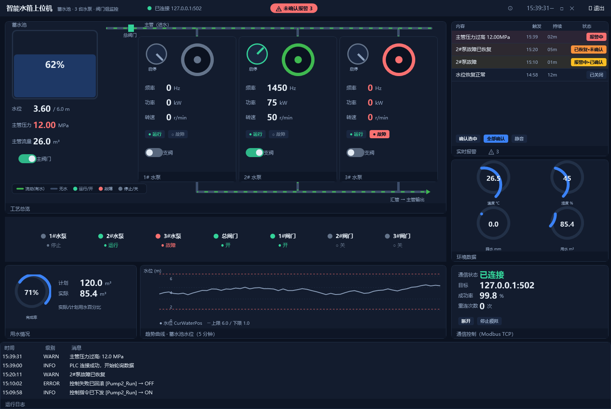
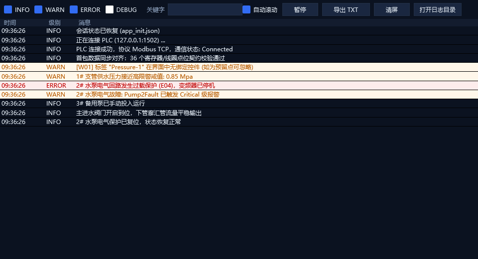
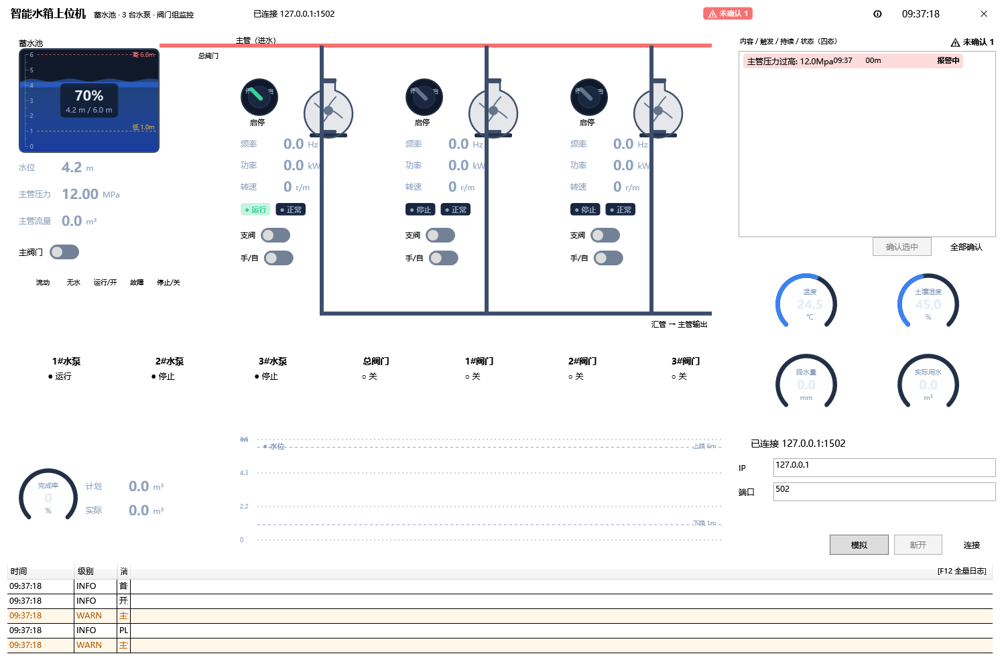
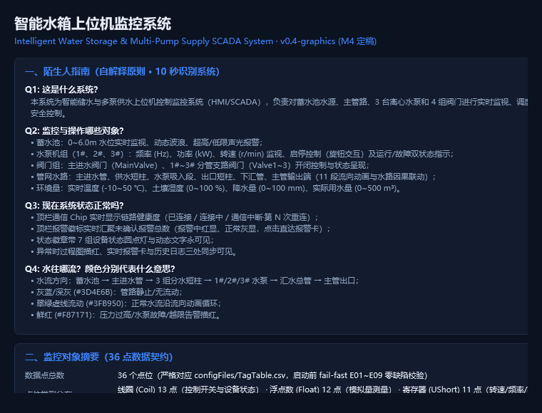
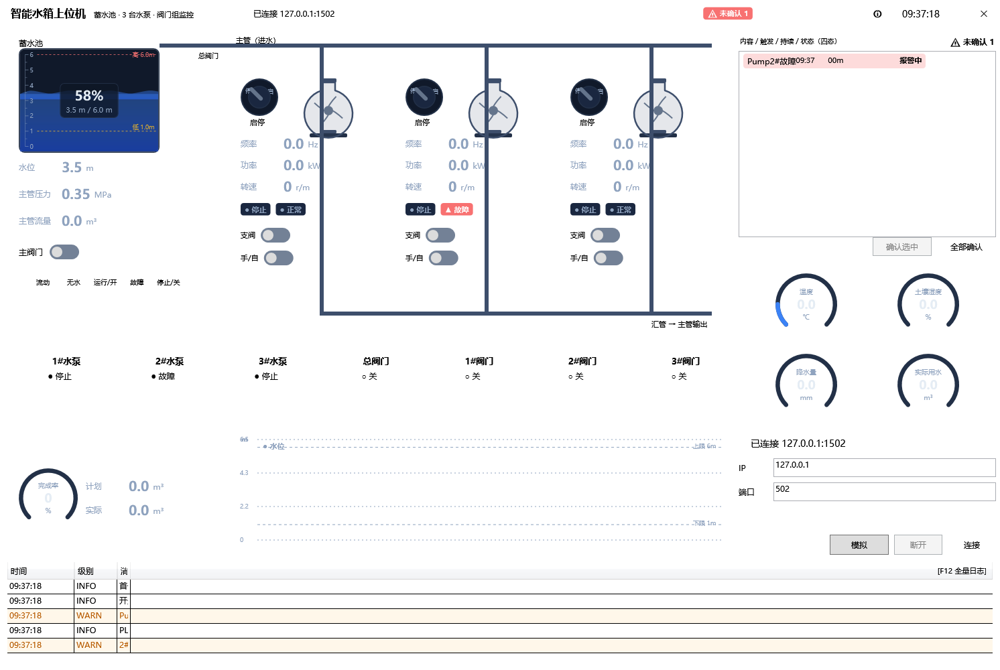
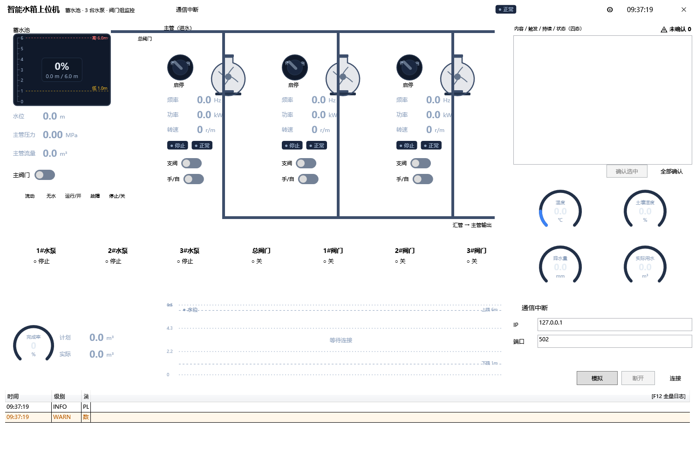
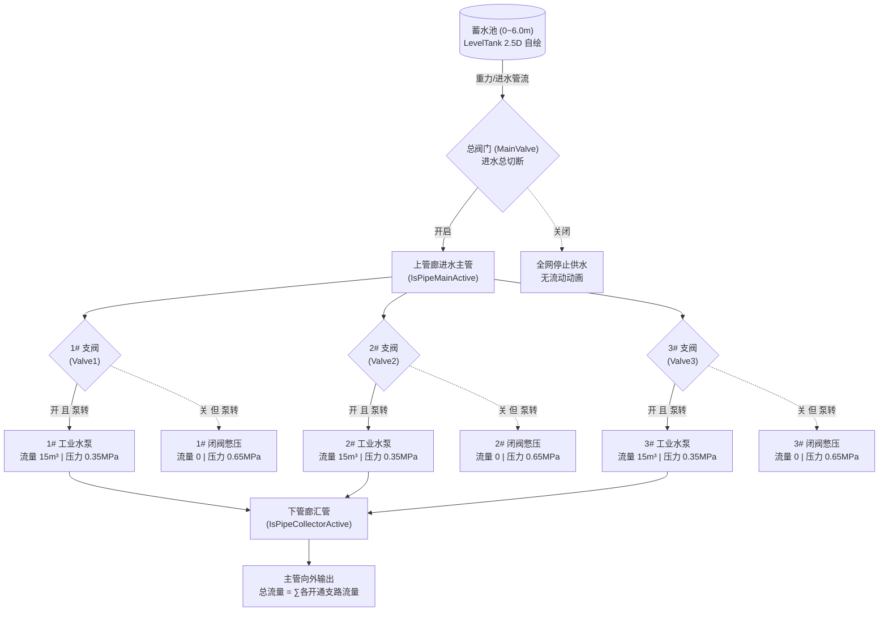

# 智能水箱与加压泵站上位机系统 (WaterSystem.Wpf)

<div align="center">

[](https://dotnet.microsoft.com/)
[](https://www.microsoft.com/)
[](https://github.com/HandyOrg/HandyControl)
[]()
[]()
[]()
[]()
[]()

**基于 .NET 8 与 WPF 的现代化工业级智能蓄水与恒压加压泵站 SCADA 监控系统**

[🖥️ 面板演示](#️-核心监控面板演示-hmi-panel-showcase) • [系统架构](#-系统架构) • [核心特性](#-核心设计与技术亮点) • [工艺因果律](#-工艺因果律与业务流程) • [人因改进台账](#-人因工程与缺陷修复-p1p18) • [快速上手](#-快速上手与运行验证) • [工程文档](#-完整工程文档索引)

</div>

---

## 📖 项目简介

**WaterSystem.Wpf** 是一套面向工业供水泵站与水务调蓄工程的现代化 SCADA 上位机监控软件。系统采用标准工业四层分层架构，具备毫秒级 Modbus TCP 异步通讯采集、高可信水路工艺模拟、零回写风暴防护、ISA-18.2 全生命周期报警管理以及严格的数据契约校验能力。

系统由传统 WinForms 架构全面平移重构而来，彻底解决了工控界面常见的**高 DPI 模糊溢出、UI 线程被网络 I/O 阻塞卡死、回写数据风暴、误触即停机、缺乏真实水动力学因果**等核心痛点，已全绿通过 224 项单元测试及 82 项端到端全链路验收测试（正式归档发布标签 **`v1.0-wpf`**）。

---

## 🖥️ 核心监控面板演示 (HMI Panel Showcase)

### 1. 工艺总览主监控大看板 (Main SCADA Dashboard)
> **自适应矢量总览大屏**（1492×1000 设计基准，支持 100%~150% DPI 矢量无级缩放）。集成 2.5D 波浪液位水箱、3 台工业水泵运行参数卡、上/下管廊动态流光水路、状态检测灯带、用水环形图、5 分钟水位趋势图、4 路环境仪表与底部实时日志网格。



---

### 2. 关键业务与交互子面板 (Key Operational Panels)

| F12 全量运行日志窗口 (多级过滤/检索/导出) | 工业安全控制二度确认弹窗 (防误触保护) |
| :---: | :---: |
|  |  |
| **四级过滤（INFO/WARN/ERROR/DEBUG）、关键字搜索、暂停分析与 TXT 导出** | **操作上下文全量提示、默认焦点锁定在【取消】（回车绝对安全）** |

| 压力浪涌超限与全廊描红联动 (Surge 报警) | 系统说明与 36 点位契约自解释 (ⓘ 帮助弹窗) |
| :---: | :---: |
|  |  |
| **ISA-18.2 四态报警追踪，管路高压描红协同告警（P4 闭环）** | **自解释原则落地件，10 秒即时解答系统用途、管廊流向与点位契约** |

| 水泵电气故障告警与红闪联动 (Fault 演练) | 通信静默与看门狗自动置灰保护 (Mute 演练) |
| :---: | :---: |
|  |  |
| **2# 水泵电气过载保护，卡底红色 `▲ 故障` 徽标声光闪烁** | **通信超时看门狗生效，全图动画安全归零，严禁显示过期数据欺骗操作员** |

---

## 🌟 核心设计与技术亮点

### 1. ISA-101 深色工业标准 HMI 视觉
- **低视觉疲劳底色**：全系统采用深蓝灰专业工业底色（`#0F172A`）与卡片分层容器（`#1E293B`），杜绝强眩光刺眼。
- **全矢量自绘工艺组件**：自绘 2.5D 波浪液位水箱（LevelTank）、270° 刻度环形仪表（RingGauge）、蜗壳工业拟物水泵（运行叶轮平滑自转、故障红闪）、管廊动态虚线流光动画（PipeLine）。
- **自适应 Viewbox 矢量缩放**：采用无边框外壳 + 全局 Viewbox 等比自适应缩放机制，在 100%、125%、150% 等任意高 DPI 屏幕及小分辨率工控屏下均不出现元素溢出或文字模糊（彻底闭环 P17）。
- **全屏随处拖动**：无边框窗口支持在任意空白背景区域鼠标左键拖拽移动。

### 2. 严密的工艺因果律（B8 因果闭环）
- **流道物理连通校验**：
  - **总进水段**：PLC 已连接且总阀门（MainValve）开启；
  - **泵支路段**：总进水通畅 **且** 对应支管阀门（Valve1~3）开启 **且** 对应水泵（Pump1~3）运转；
  - **总汇管输出段**：总进水通畅 **且** 至少有 1 台水泵支路在有效供水。
- **水动力学拟真联动**：
  - **正常供水**：开主阀 + 开支阀 + 起泵 $\rightarrow$ 支管建立额定流量（$15.0\,\text{m}^3$）与平稳工作压力（$0.35\,\text{MPa}$），主汇管输出流量累加；
  - **闭阀憋压（Deadhead 保护）**：开泵但支阀关闭 $\rightarrow$ 物理切断，流量归零，泵出口迅速上升至憋压工况（$0.65\,\text{MPa}$）；
  - **检修隔离**：关闭任一损坏泵的支阀，其余泵可继续向主汇管供水，水路绝不倒灌。

### 3. 工业级三层回写风暴防护体系（TC-V1~V9）
工控上位机最忌讳数据双向绑定导致的“上位机把旧值写回 PLC”造成严重生产事故。本系统建立三层纵深防护：
- **层 1（手势拦截）**：所有开关控件严格采用单向（`OneWay`）数据绑定，切断 WPF 双向回写链路；
- **层 2（协议隔离）**：PLC 轮询收到的新鲜数据只通过 `InitialSync` 对齐视觉状态，绝不下发控制指令；在 10,000 轮连续轮询压测下，Modbus 0x05 写计数严格为 0；
- **层 3（二度确认与乐观回滚）**：所有控制手势均弹出工业安全确认对话框（默认焦点为“取消”，敲击 Enter 绝对安全退出）；下发若遇超时或通讯中断，自动乐观回滚视觉状态并报警。

### 4. Fail-Fast 工业级数据契约体系（E01~E09 & W01~W03）
遵循工业软件“配置有误宁可不开机”的铁律：
- 启动时自动解析 [`configFiles/TagTable.csv`](configFiles/TagTable.csv)，校验 36 个点位的地址对齐、偶数双字对齐、量程比例尺、地址越界；
- **双向契约核对**：
  - `[E08]`：表中 RW 控制点在 UI 上无操作入口，报致命错误阻断开机；
  - `[E09]`：UI 绑定的点位在点位表中不存在，报致命错误阻断开机；
  - `[W01]`：表中只读测点未在前台显示，自动标记为“现场预留点”并提示，不影响平稳运行。

### 5. ISA-18.2 全生命周期四态报警中心
- **四态状态机流转**：
  $$\text{正常} \longrightarrow \text{报警中·未确认} \longrightarrow \text{报警中·已确认} \longrightarrow \text{已恢复·未确认} \longrightarrow \text{已关闭}$$
- **三处同步协同告警**：触发超限报警时，顶栏徽标（`⚠ 未确认` 活计数）、实时报警卡（行高亮）、过程画面（主管路全廊描红）三处同步响应；
- **掉电持久化**：报警事件基于 SQLite 本地数据库（`history.db`）落库存储，掉电重启历史可追溯。

### 6. 高可靠通信与工业劣化自愈能力
- 异步非阻塞 Socket 通信引擎，内置指数退避重连机制（1s $\rightarrow$ 2s $\rightarrow$ 4s $\rightarrow$ 8s $\rightarrow$ 16s $\rightarrow$ 30s 封顶）；
- 内置看门狗（Watchdog），距上次成功轮询超过 3 个周期即标记数据过期，界面元件自动安全置灰复位，绝不显示过期读数欺骗操作员；
- 通过内置从站模拟器完成 5 大恶劣工况演练：**TCP 分片（Frag 0 错帧）、丢包（Drop 容错）、静默（Mute 自愈）、压力浪涌（Surge 报警）、电气故障（Fault 流转）**。

---

## 🏗️ 系统架构

```
water-system-wpf/
├── src/
│   ├── WaterSystem.Core/             # 纯净 .NET 8 业务与协议类库（零 UI 依赖，可跨平台复用）
│   │   ├── Communication/            # Modbus TCP 异步客户端、帧编解码、统计指标
│   │   ├── Control/                  # 控制决策管道、ISA-18.2 报警中心 (AlarmCenter)
│   │   ├── Model/                    # 标签地址模型 (TagAddress)、系统状态、报警配置
│   │   ├── Persistence/              # SQLite 历史数据库记录器 (HistoryLogger)
│   │   ├── Services/                 # 数据轮询调度 (DataPollingService)、控制服务、报警评估
│   │   ├── Simulation/               # 进程内/从站场景引擎 (ScenarioEngine)、数据仓储 (DataStore)
│   │   └── Utils/                    # TagTableLoader (契约加载)、RegisterCodec (字序编解码)
│   │
│   └── WaterSystem.Wpf/              # 现代化 WPF 工业桌面交互程序 (net8.0-windows)
│       ├── Binding/                  # 工业级 TagBinding 标记扩展与双向注册表
│       ├── Controls/                 # LevelTank、PumpGraphic、PipeLine、RingGauge、WaterTrendChart 等自绘控件
│       ├── Infrastructure/           # UiDispatcher 跨线程调度、CommandManager 状态刷新
│       ├── Services/                 # LogRowStyler (主网格与 F12 统一行着色引擎)
│       ├── State/                    # AppStateStore (会话参数持久化与恢复)
│       ├── Themes/                   # Dark.xaml (ISA-101 深色工业调色板令牌)
│       ├── ViewModels/               # MainViewModel、ControlViewModel、AlarmPanelViewModel
│       └── Views/                    # MainWindow、LogViewerWindow (F12 全量日志)、ConfirmDialog、FailFastWindow
│
├── tests/
│   ├── WaterSystem.Core.Tests/       # 129 项 Core 核心单元测试（协议/模型/编解码/状态机）
│   └── WaterSystem.Wpf.Tests/        # 95 项 WPF 交互与集成测试（回写防护/因果验证/回归矩阵）
│
├── tools/
│   ├── ModbusSlaveSim/               # 独立 Modbus TCP 从站模拟器（支持网络劣化注入）
│   └── TestRunner/                   # 端到端自动化验收套件（82 项工业级用例一键全绿）
│
├── configFiles/
│   ├── TagTable.csv                  # 系统数据契约点位表（36 个寄存器/线圈点位规范）
│   └── AlarmConfig.json              # 报警阈值与安全限值配置文件
│
└── docs/                             # 完整工业设计书、架构迁移方案、实施细则与测试验收记录
```

---

## 📊 工艺因果律与业务流程



---

## 🛠️ 人因工程与缺陷修复 (P1~P18)

| 编号 | 原始 WinForms 缺陷表象 | WPF 现代化重构落地措施 | 对应模块 |
|:---:|---|---|---|
| **P1** | 浮点数全精度直出（如 3.59625473 m） | `ValueFormatter` 按 Scale 有效位严格推导定宽格式（2.55 / 0.35 / 26.5） | Core.Utils |
| **P2** | 参数名与状态中英文混杂 | 统一人机工学中文规范术语与国家工业语义标准 | Core.Model |
| **P3** | 水泵/阀门状态无图仅文字，缺乏立体感 | 自绘工业蜗壳+叶轮拟物水泵，运行叶轮自转，故障声光红闪 | Wpf.Controls |
| **P4** | 压力超限仅有日志文字，工艺图无感知 | 主管压力 >10.0Mpa 时全管廊描红，实时卡、顶栏徽标、管路三处同步高亮 | Wpf.Views |
| **P5/P6**| 状态灯仅变色不变字、文字歧义 | 徽章文字随状态动态切换（● 运行 / ○ 停止 / ▲ 故障），色弱友好 | Wpf.Controls |
| **P7** | 水池与水箱缺少直观水位指示 | 自绘 2.5D 波浪液位水箱（LevelTank）+ 270° 刻度环形仪表（RingGauge） | Wpf.Controls |
| **P8** | 控制按钮无操作防误触提示 | `ConfirmDialog` 二度确认对话框，默认焦点为"取消"，回车绝对安全 | Wpf.ViewModels |
| **P9** | 控制指令发出后无法识别响应状态 | 按钮增加 busy 状态抑制防重入，写失败自动回滚乐观状态并记入日志 | Wpf.ViewModels |
| **P10** | 水位趋势图无刻度、阈值与单位 | `WaterTrendChart` 自绘 Polyline，标注明确 Y 轴单位 "m" 及红虚线报警阈值 | Wpf.Controls |
| **P11** | 日志窗口滚动行高不均、截断换行 | DataGrid 严格定高 22px，表头 26px，级别单行 64px 独立分列显示 | Wpf.Views |
| **P12** | 报警只有最新一条，无法回溯确认 | 顶栏集成 `⚠ 未确认` 实时徽标，实时报警卡提供逐项/全部确认闭环 | Wpf.ViewModels |
| **P13** | 通信状态在折叠区隐蔽不可见 | 顶栏常驻三态通信状态 Chip（已连接/离线/通信中断），全屏全局可见 | Wpf.Views |
| **P14** | 窗口直接关闭缺少保护 | 捕获窗口关闭事件，弹出工业安全退出确认对话框，默认聚焦"取消" | Wpf.Views |
| **P15** | 管道流动状态静止无水流感知 | 11 段管道根据泵和阀门开闭状态计算水流拓扑，支持双向水流虚线平滑流动动画 | Wpf.Controls |
| **P16** | 误按回车直接触发默认操作 | 全局弹窗取消默认 Enter 提交，统一默认绑定 `IsCancel=true` 安全退出 | Wpf.Views |
| **P17** | 高 DPI 屏幕（125%/150%）标题栏溢出不可达 | 外层包裹 Viewbox 矢量等比缩放，窗口自适应工作区边界，关闭钮永远可见 | Wpf.MainWindow |
| **P18** | 缺少陌生人可用性帮助说明 | 顶栏 ⓘ 按钮弹出 `SystemInfoWindow`，即时解答系统用途、点位契约与通信协议 | Wpf.Views |

---

## 🚀 快速上手与运行验证

### 1. 环境准备
- 操作系统：Windows 10 / Windows 11 x64
- 开发框架：[.NET 8.0 SDK](https://dotnet.microsoft.com/download/dotnet/8.0)（建议 >= 8.0.300）
- 开发工具：Visual Studio 2022 或 JetBrains Rider / VS Code

### 2. 构建与运行
```powershell
# 克隆仓库
git clone https://github.com/make669/water-system-wpf.git
cd water-system-wpf

# 编译整个解决方案
dotnet build

# 启动上位机主程序
dotnet run --project src/WaterSystem.Wpf
```
> **提示**：启动后，直接点击右上角【模拟】按钮，上位机将自动拉起内置虚拟从站，一秒建立连接并开始实时仿真演练。

### 3. 执行自动化测试
```powershell
# 运行全部 224 项单元测试与集成测试（Core 129 项 + WPF 95 项）
dotnet test

# 运行 82 项端到端全链路自动化验收套件（自动拉起从站演习通讯劣化）
dotnet run --project tools/TestRunner
```

---

## 📑 完整工程文档索引

项目根目录 `docs/` 下归档了全套规范化的工业设计与实施文档：

1. **[docs/系统总体设计.md](docs/系统总体设计.md)**：分层架构、线程模型、契约管理与核心生命周期规划
2. **[docs/WinForms转WPF迁移实施方案.md](docs/WinForms转WPF迁移实施方案.md)**：旧系统技术债务清理路线、零回写风暴防护规约
3. **[docs/WPF-UI详细设计书.md](docs/WPF-UI详细设计书.md)**：九宫格分区规格、自绘控件尺寸、管廊拓扑图
4. **[docs/UI人性化设计概要.md](docs/UI人性化设计概要.md)**：ISA-101 深色视觉规范、自解释图例、P1~P18 缺陷台账
5. **[docs/WPF实施细则.md](docs/WPF实施细则.md)**：M0~M9 里程碑工期、任务拆解与交付物定义
6. **[docs/验收记录-M9.md](docs/验收记录-M9.md)**：全量回归矩阵与 5 大网络劣化演练通过记录

---

## 📄 许可证

本项目基于 [MIT License](LICENSE) 开源。遵循严谨的工业软件工程标准与 Git 分支开发纪律。
